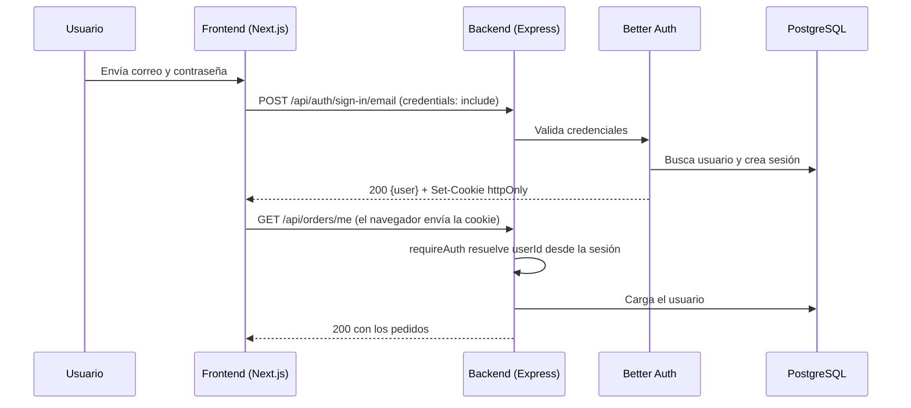
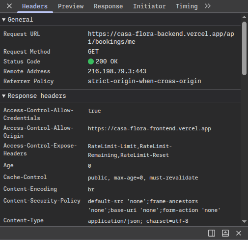

# Casa Flora Backend

API REST de **Casa Flora**, una cocina oculta (dark kitchen) de comida típica colombiana en Medellín. Gestiona autenticación, catálogo de platos, pedidos con pago en línea (Mercado Pago), reservas de mesa y subida de imágenes de producto.

## 1. Qué es el proyecto

El sistema se divide en dos repositorios desplegados en Vercel:

| Parte | Repositorio | Despliegue |
| --- | --- | --- |
| Frontend (Next.js) | `kevincifuentesdev/casa-flora-frontend` | <https://casa-flora-frontend.vercel.app> |
| Backend (este repo, Express) | `kevincifuentesdev/casa-flora-backend` | <https://casa-flora-backend.vercel.app> |

Verificación rápida del backend desplegado: `GET https://casa-flora-backend.vercel.app/api/health` debe responder `{"status":"ok","service":"casa-flora-backend", ...}`.

### Stack

- **Node.js ≥ 22.12**, **Express 5**, **TypeScript** (ESM).
- **PostgreSQL en Neon** con **Prisma 7** (`@prisma/adapter-pg`).
- **Better Auth** (email/contraseña + username + plugin JWT con claves Ed25519).
- **Zod** para validar variables de entorno y cuerpos/consultas/parámetros.
- **Helmet**, **CORS** con lista de orígenes y **express-rate-limit**.
- **Mercado Pago** (Checkout Pro) para pagos y **Neon Object Storage (S3)** para imágenes.
- **Vitest** para pruebas.

### Arquitectura (Clean Architecture)

```
src/
├── domain/           Modelos y contratos de repositorio (sin dependencias externas)
├── application/      Casos de uso y errores de negocio (AppError, 401, 403, 404...)
├── infrastructure/   Prisma, DTOs Zod, servicios (auth, pagos, S3, env, logger)
└── interface/        Routers, controladores y middlewares de Express
prisma/               schema.prisma, migraciones y seed del catálogo
api/index.ts          Entrada serverless para Vercel
tests/                Pruebas de la API
```

### Endpoints principales

Todas las rutas cuelgan de `/api` (también responden sin el prefijo).

| Método y ruta | Acceso | Descripción |
| --- | --- | --- |
| `GET /health` | Público | Estado del servicio |
| `ALL /auth/*` | Público | Registro, login, logout y sesión (Better Auth) |
| `GET /products` | Público | Catálogo con filtros, orden y paginación |
| `GET /products/:id` | Público | Detalle de un plato |
| `GET /products/admin` | Admin | Catálogo completo (incluye agotados) |
| `POST/PATCH/DELETE /products` | Admin | Crear, editar y eliminar platos |
| `POST /uploads/products` | Admin | Subir imagen de plato |
| `GET/PATCH /users/me` | Usuario | Perfil |
| `POST /users/me/onboarding`, `/addresses`, `/payment-methods` | Usuario | Preferencias, direcciones y medios de pago guardados |
| `POST /orders/checkout`, `POST /orders/checkout/verify` | Usuario | Crear preferencia de Mercado Pago y verificar el pago |
| `GET /orders/me`, `PATCH /orders/:id/cancel` | Usuario | Mis pedidos |
| `GET /orders/admin`, `PATCH /orders/:id/status` | Admin | Gestión de pedidos |
| `GET /bookings/availability` | Público | Aforo por turno y ambiente |
| `POST /bookings`, `GET /bookings/me`, `PATCH /bookings/:id/cancel` | Usuario | Reservas propias |
| `GET /bookings/admin`, `PATCH /bookings/:id` | Admin | Gestión de reservas |

#### Paginación

`GET /products`, `/products/admin`, `/orders/admin`, `/orders/me`, `/bookings/admin` y `/bookings/me` aceptan `?page=1&limit=10`. La respuesta incluye en `meta`: `total`, `page`, `limit`, `totalPages`, `hasNextPage`, `hasPrevPage`. Si se omiten `page` y `limit` se devuelven todos los elementos (compatibilidad hacia atrás).

#### Cancelación automática de pedidos (90 segundos)

Si un pedido creado mediante Mercado Pago no verifica su pago dentro de un plazo de **90 segundos**, el backend lo cancela automáticamente (`status: "cancelled"` con detalle `Mercado Pago (Cancelado tras 90 segundos sin verificación de pago)`). Tanto la ruta de verificación (`POST /api/orders/checkout/verify`), un temporizador en segundo plano, y la consulta de pedidos aplican esta expiración. En el frontend, el drawer del carrito despliega un temporizador visual descendente de 90 segundos y cancela el pedido pendiente si se agota el tiempo sin confirmación.

#### Formato de error

```json
{ "error": { "code": "FORBIDDEN", "message": "No tienes permisos para realizar esta acción." } }
```

## 2. Cómo correrlo en local

### Requisitos

- Node.js 22.12 o superior y **pnpm**.
- Una base de datos PostgreSQL (se usa Neon; sirve cualquier Postgres).
- Un access token de prueba de Mercado Pago (para el checkout).

### Pasos

```bash
git clone git@github.com:kevincifuentesdev/casa-flora-backend.git
cd casa-flora-backend
pnpm install            # ejecuta prisma generate automáticamente
cp .env.example .env    # completar los valores (ver tabla)
pnpm prisma:deploy      # aplica las migraciones a la base de datos
pnpm db:seed            # carga el catálogo de platos (ver advertencia)
pnpm dev                # http://localhost:4000
```

> [!WARNING]
> `pnpm db:seed` ejecuta un `TRUNCATE ... CASCADE` sobre usuarios, sesiones, pedidos, reservas y productos antes de insertar el catálogo. **No lo ejecutes sobre una base con datos que quieras conservar.**

### Scripts

| Script | Función |
| --- | --- |
| `pnpm dev` | Servidor con recarga (`tsx watch`) |
| `pnpm build` / `pnpm start` | Compilar a `dist/` y ejecutar |
| `pnpm test` | Pruebas con Vitest |
| `pnpm lint` / `pnpm typecheck` | ESLint y TypeScript |
| `pnpm prisma:migrate` | Crear migración en desarrollo |
| `pnpm prisma:deploy` | Aplicar migraciones existentes |
| `pnpm db:seed` | Sembrar catálogo |

### Variables de entorno

Se validan con Zod al arrancar ([`env.service.ts`](./src/infrastructure/services/env.service.ts)); si falta o es inválida alguna, el servidor no inicia y lista los errores.

| Variable | Obligatoria | Por defecto | Descripción |
| --- | --- | --- | --- |
| `NODE_ENV` | No | `development` | `development`, `test` o `production` |
| `PORT` | No | `4000` | Puerto HTTP |
| `DATABASE_URL` | **Sí** | n/a | Cadena Postgres (pooler de Neon) |
| `DIRECT_URL` | No | n/a | Cadena directa, usada por Prisma para migraciones |
| `BETTER_AUTH_URL` | No | `http://localhost:4000` | URL pública del backend (emisor del JWT) |
| `BETTER_AUTH_SECRET` | **Sí** | n/a | Secreto de ≥ 32 caracteres (`openssl rand -base64 48`). En producción no puede contener `change-me` |
| `CORS_ORIGINS` | No | `http://localhost:3000` | Orígenes permitidos separados por coma (p. ej. la URL del frontend) |
| `TRUST_PROXY` | No | `false` | `true` detrás de proxy (Vercel) para leer la IP real |
| `COOKIE_DOMAIN` | No | n/a | Dominio para cookies entre subdominios |
| `JWT_AUDIENCE` | No | `casa-flora` | Audiencia del JWT |
| `JWT_EXPIRES_IN` | No | `15m` | Vigencia del JWT |
| `PAYMENT_SECRET` | **Sí** (fuera de `test`) | n/a | Access token de Mercado Pago (`TEST-...` o `APP_USR-...`) |
| `PAYMENT_TEST_USER_ID`, `PAYMENT_TEST_USER`, `PAYMENT_TEST_PSW`, `PAYMENT_TEST_CODE` | No | n/a | Datos de la cuenta compradora de prueba de Mercado Pago |
| `INTERIOR_CAPACITY` | No | `40` | Aforo del Salón Interior por turno |
| `PATIO_CAPACITY` | No | `24` | Aforo del Patio por turno |
| `AWS_ENDPOINT_URL_S3`, `AWS_ACCESS_KEY_ID`, `AWS_SECRET_ACCESS_KEY` | No* | n/a | Credenciales de Neon Object Storage (*necesarias para subir imágenes) |
| `AWS_REGION` | No | `us-east-1` | Región del bucket |
| `S3_BUCKET` | No | `casa-flora` | Nombre del bucket |

En Vercel se configuran las mismas variables en el panel del proyecto, con `NODE_ENV=production`, `TRUST_PROXY=true` y `CORS_ORIGINS` apuntando al frontend desplegado.

## 3. Credenciales de prueba (solo ambiente de la entrega)

> El script [`prisma/seed.ts`](./prisma/seed.ts) actual **solo siembra el catálogo de platos**; no crea usuarios. Las cuentas siguientes deben existir en la base de datos de la entrega.

| Rol | Correo / usuario | Contraseña |
| --- | --- | --- |
| Administrador | admin | AdminPassword123* |
| Usuario (customer) | testvercel | test123456 |

**Cómo se crea un admin:** el registro (`/api/auth/sign-up/email`) siempre fuerza `role = "customer"` y el campo `role` no acepta entrada del cliente (`input: false`), por lo que nadie puede autoasignarse admin. Para promover una cuenta ya registrada:

```sql
UPDATE "user" SET role = 'admin' WHERE email = 'admin@ejemplo.com';
```

Un admin no puede crear pedidos ni reservas como cliente (la API lo rechaza), por eso se necesita una segunda cuenta `customer` para probar el flujo de compra.

### Mercado Pago: cuentas y tarjetas de prueba

El checkout corre en modo sandbox con el token de prueba de `PAYMENT_SECRET`. Para probar:

1. Inicia sesión con el usuario `customer`, agrega platos al carrito y pulsa pagar.
2. En la pantalla de Mercado Pago usa una de las tarjetas de prueba oficiales (Colombia):

| Tarjeta | Número | CVV | Vencimiento |
| --- | --- | --- | --- |
| Mastercard | `5254 1336 7440 3564` | `123` | `11/30` |
| Visa | `4013 5406 8274 6260` | `123` | `11/30` |
| Visa Debito | `4915 1120 5524 6507` | `123` | `11/30` |

El **nombre del titular** define el resultado de la prueba:

| Nombre del titular | Resultado |
| --- | --- |
| `APRO` | Pago aprobado |
| `OTHE` | Rechazado por error general |
| `CONT` | Pendiente de pago |
| `FUND` | Rechazado por fondos insuficientes |
| `SECU` | Rechazado por código de seguridad inválido |
| `EXPI` | Rechazado por fecha de vencimiento |

Documento del titular: tipo `CC`, número `123456789`. Correo: cualquier correo válido.

3. Tras pagar, el frontend llama a `POST /api/orders/checkout/verify` y el pedido pasa de `pending` a `preparing` si el pago fue aprobado.

Si prefieres usar la **cuenta compradora de prueba** de Mercado Pago (usuario y contraseña de prueba creados desde el panel de desarrolladores), sus datos van en `PAYMENT_TEST_USER`, `PAYMENT_TEST_PSW` y `PAYMENT_TEST_CODE` de tu `.env`:

| Dato | Valor |
| --- | --- |
| ID del Usuario | ``
| Usuario | `TESTUSER7855678307701836964` |
| Contraseña | `SJ55QkU4A9` |
| Código de verificación | `947796` |

> Las tarjetas de prueba pueden cambiar; la lista vigente está en la documentación oficial de Mercado Pago ("Tarjetas de prueba").

## 4. Decisiones técnicas

### 4.1 Flujo completo de un login

1. **Formulario**: el usuario envía correo (o username) y contraseña en el frontend. [`authService.ts`](../frontend/src/features/auth/services/authService.ts) hace `POST /api/auth/sign-in/email` con `credentials: "include"`.
2. **Capa de seguridad**: Express aplica Helmet, CORS (solo orígenes permitidos) y el rate limit; Better Auth limita además el login a 10 intentos por minuto.
3. **Better Auth** ([`auth.service.ts`](./src/infrastructure/services/auth.service.ts)) busca el usuario, compara el hash de la contraseña y, si es correcto, crea una fila en la tabla `session` (vigencia 7 días).
4. **Respuesta**: devuelve los datos del usuario y fija la cookie `casa-flora.session_token` con `httpOnly`, `secure` y `sameSite=none` en producción. JavaScript del frontend no puede leer esa cookie.
5. **Frontend**: guarda en `localStorage` solo el perfil del usuario para pintar la interfaz ([`sessionService.ts`](../frontend/src/features/auth/services/sessionService.ts)). **No guarda ningún token.** Al cargar, `GET /api/users/me` valida la sesión con la cookie y limpia el perfil si responde 401.
6. **Petición protegida**: todas las llamadas usan `credentials: "include"` ([`apiClient.ts`](../frontend/src/features/common/services/apiClient.ts) y [`authClient.ts`](../frontend/src/features/auth/services/authClient.ts)), así que el navegador adjunta la cookie automáticamente.
7. **CORS**: el backend (`https://casa-flora-backend.vercel.app`) responde con `Access-Control-Allow-Origin` igual al origen del frontend (nunca `*`) y `Access-Control-Allow-Credentials: true`. Sin esas dos cabeceras el navegador descartaría la cookie en una petición entre dominios.
   Luego `requireAuth` ([`auth.middleware.ts`](./src/interface/middlewares/auth.middleware.ts)) llama a `AuthService.resolveUserId`, que lee la cookie, busca la sesión en la tabla `session` y comprueba que no haya expirado. Con el `userId` carga el usuario desde la base de datos y lo deja en `res.locals.user`.
8. **Rutas de admin** usan `requireAdmin`, que además exige `user.role === "admin"`.
9. El controlador responde con los datos. Si algo falla, el middleware de errores serializa el `AppError` con su código HTTP.



### 4.2 Dónde se guarda el token y qué riesgo tiene

La sesión vive en una **cookie `httpOnly`** con `Secure` y `SameSite=None`, emitida por el backend. El frontend no puede leerla, así que un ataque **XSS** no puede robar el token (a lo sumo podría hacer peticiones mientras la página esté abierta). En `localStorage` solo queda el perfil del usuario para la interfaz, nunca credenciales.

**Riesgos y mitigaciones de esta decisión:**

- **CSRF**: el navegador envía la cookie automáticamente, incluso desde otro sitio. Se mitiga con CORS restringido a orígenes permitidos (no se acepta `*` con credenciales), el control de `trustedOrigins` de Better Auth y mutaciones solo por `POST/PATCH/DELETE` con cuerpo JSON.
- **Cookies de terceros**: el frontend (`casa-flora-frontend.vercel.app`) y el backend (`casa-flora-backend.vercel.app`) son sitios distintos (`vercel.app` está en la Public Suffix List), por lo que `SameSite=None; Secure` es obligatorio y algunos navegadores con bloqueo estricto de cookies de terceros (por ejemplo Safari) pueden rechazarla. La solución robusta es servir ambos bajo un mismo dominio propio y configurar `COOKIE_DOMAIN`.

### 4.3 Cuándo responde 401 y cuándo 403

- **401 Unauthorized**: la API no sabe quién eres (no hay token, expiró o es inválido). Ejemplo real: un visitante sin sesión llama a `GET /api/orders/me` y `requireAuth` lanza `UnauthorizedError` → `401 UNAUTHORIZED`: "No has iniciado sesión o tu sesión ha expirado."
- **403 Forbidden**: sabe quién eres, pero no tienes permiso. Ejemplo real: un usuario `customer` autenticado llama a `GET /api/orders/admin` o `POST /api/products`; `requireAdmin` ve que `role !== "admin"` y lanza `ForbiddenError` → `403 FORBIDDEN`. También devuelve 403 un origen CORS no permitido (`CORS_ORIGIN_FORBIDDEN`).

Estos casos están cubiertos en [`tests/api.spec.ts`](./tests/api.spec.ts) ("enforces authentication and admin authorization on product mutations").

### 4.4 Uso de IA

Usé un asistente de IA (Antigravity) como apoyo para:

- Estructurar los endpoints administrativos, la paginación y las pruebas de la API.
- Maquetar páginas del frontend (términos, privacidad, FAQ, acerca de).
- Redactar esta documentación.

Lo que tuve que corregir o validar manualmente:

- Una prueba de paginación asumía 12 productos, pero otra prueba del mismo archivo creaba un decimotercer plato en el repositorio en memoria; hubo que ajustar la aserción a 13.
- Una regla de ESLint (`react-hooks/set-state-in-effect`) rechazó el reinicio de la página dentro de un `useEffect`; se movió a los manejadores de eventos.
- Revisé que la paginación fuera retrocompatible: sin `page` ni `limit` se devuelven todos los elementos para no romper al frontend ni las pruebas existentes.

## 5. Evidencia: petición protegida con cookie `httpOnly` y CORS

Captura de la pestaña **Network** (DevTools) de una petición protegida, por ejemplo `GET https://casa-flora-backend.vercel.app/api/users/me`, mostrando:

- *Request Headers*: `Cookie: casa-flora.session_token=...` y `Origin: https://casa-flora-frontend.vercel.app`.
- *Response Headers*: `Access-Control-Allow-Origin` con el origen del frontend y `Access-Control-Allow-Credentials: true`.
- Estado `200`. En *Application → Cookies* se ve la cookie con las marcas `HttpOnly`, `Secure` y `SameSite=None`.



Capturas adicionales (opcional):


## 6. Pruebas

```bash
pnpm test
```

Cubren validación de dominio, cabeceras de seguridad, filtros y orden del catálogo, autorización (401 y 403), perfil, onboarding, reservas con control de aforo, checkout con Mercado Pago, subida de imágenes y paginación.

